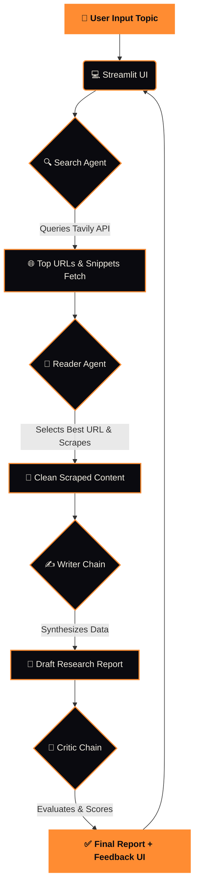

<div align="center">
  
  <h1>🚀 Multi-Agent Research System</h1>
  <p><i>An intelligent, multi-agent AI research assistant powered by Groq, LangChain, and Streamlit.</i></p>

  [](https://python.org)
  [](https://streamlit.io)
  [](https://langchain.com/)
  [](https://groq.com)
</div>

---

## 🌟 Overview
**ResearchMind** utilizes the power of specialized AI agents working collaboratively to automate deep research. Enter any topic, and watch as our agents search the web, scrape deep content, draft comprehensive reports, and critically review them entirely autonomously!

## ⚙️ Architecture & Flow Diagram

The system employs a 4-stage pipeline passing critical state data to ensure the highest research quality.



## ✨ Agent Roles
- **🔍 Search Agent:** Autonomously scours the web for the latest, most reliable information using the Tavily API.
- **📄 Reader Agent:** Deep-dives into the most relevant URLs, accurately scraping and cleaning text content.
- **✍️ Writer Chain:** Synthesizes the gathered intelligence into a beautifully structured Markdown report.
- **🧐 Critic Chain:** Acts as a strict quality-control reviewer, scoring the draft and suggesting areas to improve.

## 🚀 Getting Started

### 1. Clone the repository
```bash
git clone https://github.com/udayrastogi0531/Multi-Agent-Research-System.git
cd Multi-Agent-Research-System
```

### 2. Install dependencies
Ensure you have Python 3.9+ installed.
```bash
pip install -r requirements.txt
```

### 3. Setup Environment Variables
Create a `.env` file in the root directory and add your API keys:
```env
GROQ_API_KEY="your_groq_api_key_here"
TAVILY_API_KEY="your_tavily_api_key_here"
Demo https://multi-agent-research-system-o7ul.onrender.com/
```
*(Get your Groq API key from [GroqCloud](https://console.groq.com) and Tavily API key from [Tavily](https://tavily.com))*

### 4. Run the App
```bash
streamlit run app.py
```

---
<div align="center">
  <i>Built with ❤️ by Uday Rastogi</i>
</div>
  live https://multi-agent-research-system-ddk3knbpwwjz6nagswcati.streamlit.app/
  https://multi-agent-research-system-o7ul.onrender.com/
