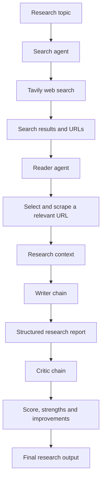

<div align="center">

# 🔬 ResearchMind — Multi-Agent Research System

### From a topic to a researched, written and critically reviewed report.

[](https://python.org)
[](https://streamlit.io)
[](https://python.langchain.com/)
[](https://groq.com/)
[](https://tavily.com/)

[Repository](https://github.com/udayrastogi0531/Multi-Agent-Research-System) · [Issues](https://github.com/udayrastogi0531/Multi-Agent-Research-System/issues)

</div>

---

## Overview

ResearchMind is a Streamlit-based research assistant that coordinates specialized LLM agents and chains to gather information, inspect a relevant source, draft a report and critique the result.

Instead of asking one model to do every step in a single prompt, the pipeline separates web discovery, deeper reading, report writing and review into distinct stages.

## System workflow



## Agent responsibilities

| Component | Responsibility |
|---|---|
| Search agent | Uses the Tavily web-search tool to find recent information, titles, URLs and snippets |
| Reader agent | Uses a URL-scraping tool to retrieve readable page content |
| Writer chain | Produces a report with introduction, key findings, conclusion and source URLs |
| Critic chain | Reviews the generated report and returns a score, strengths, improvement areas and verdict |

The agents use Groq's ChatGroq integration with the Llama 3.3 70B Versatile model as configured in the current implementation.

## Technology

- **UI:** Streamlit
- **Agent orchestration:** LangChain agent interface
- **Model provider:** Groq
- **Search:** Tavily
- **Page extraction:** Requests and BeautifulSoup
- **Configuration:** python-dotenv

## Repository layout

```text
.
├── app.py             # Streamlit application
├── agents.py          # Search/reader agents, writer and critic chains
├── tools.py           # Tavily search and URL scraping tools
├── pipeline.py        # Four-stage research pipeline
├── requirements.txt
├── .env.example
└── DEPLOYMENT.md
```

## Run locally

1. Clone the repository and enter the project directory.

```bash
git clone https://github.com/udayrastogi0531/Multi-Agent-Research-System.git
cd Multi-Agent-Research-System
```

2. Create and activate a virtual environment.

```bash
python -m venv .venv
```

Windows PowerShell:

```powershell
.venv\Scripts\Activate.ps1
```

macOS / Linux:

```bash
source .venv/bin/activate
```

3. Install dependencies.

```bash
pip install -r requirements.txt
```

4. Create a local .env file from the example and add your own API keys.

```env
GROQ_API_KEY=your_groq_api_key
TAVILY_API_KEY=your_tavily_api_key
```

5. Launch the Streamlit interface.

```bash
streamlit run app.py
```

The command-line pipeline can also be run with:

```bash
python pipeline.py
```

## Important limitations

- Search quality depends on the Tavily results and the topic.
- The reader agent scrapes a selected URL; websites may block requests or return incomplete content.
- The report and critic are LLM-generated and require human fact-checking.
- This project is a research workflow demonstration, not an autonomous fact-verification service.
- Keep API keys in environment variables; never commit a real .env file.

## Author

**Uday Prakash Rastogi** · [GitHub](https://github.com/udayrastogi0531) · [LinkedIn](https://www.linkedin.com/in/uday-prakash-rastogi-33b55a2a2/)
